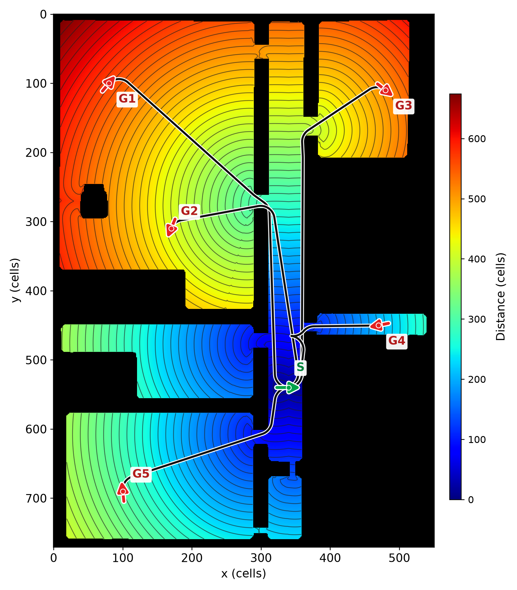
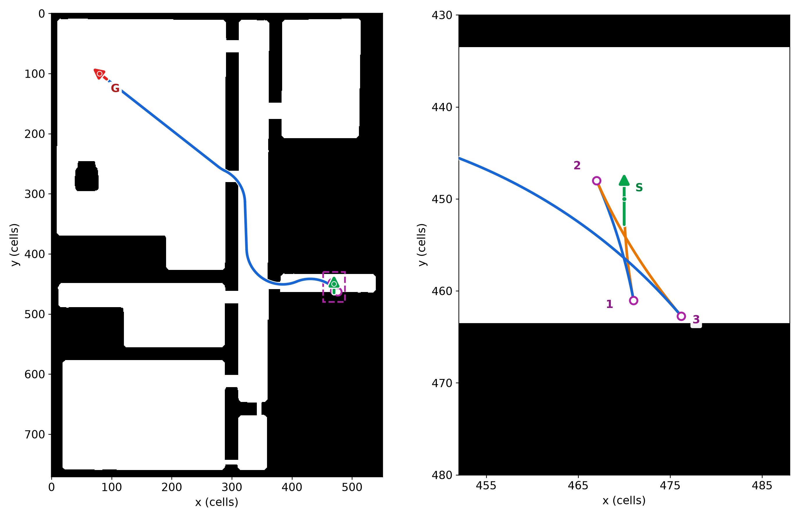
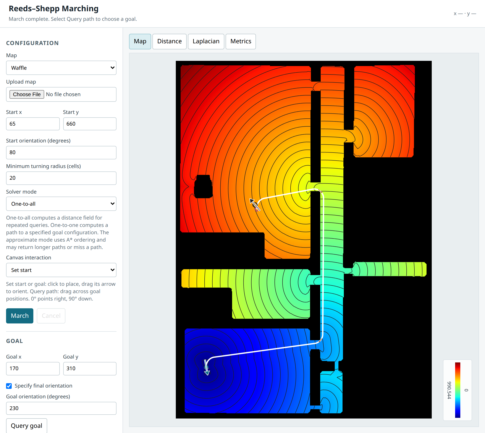

# Kinematically Constrained Reeds–Shepp Marching

Implementation and extension of **[Kinematically Constrained Marching for Optimal
Reeds–Shepp Nonholonomic Path Planning on 2-D Cartesian Grids](https://ieeexplore.ieee.org/document/11534126)**,
by Ibrahim Ibrahim, Wilm Decré and Jan Swevers, published in
*IEEE Transactions on Robotics* (2026). The [paper implementation](#paper-implementation-and-migration)
remains available separately from this geometric update.

<details>
<summary>Cite this work (BibTeX)</summary>

For the underlying method, cite the paper and record the code revision used:

```bibtex
@ARTICLE{11534126,
  author={Ibrahim, Ibrahim and Decré, Wilm and Swevers, Jan},
  journal={IEEE Transactions on Robotics},
  title={Kinematically Constrained Marching for Optimal Reeds–Shepp Nonholonomic Path Planning on 2-D Cartesian Grids},
  year={2026},
  volume={42},
  pages={2215-2230},
  doi={10.1109/TRO.2026.3695992}
}
```

</details>

This C++20 planner computes a **one-to-all Reeds–Shepp distance field** on a 2D
occupancy grid: path lengths from a specified start configuration to goal
positions, with the final orientation chosen by the planner. It also supports
queries between **fully specified start and goal configurations**.

The vehicle can move forward and backward with a specified minimum turning
radius. A local browser GUI lets you display the field and query paths to
different goals.

A vehicle configuration is $(x,y,\theta)$: position $(x,y)$ and orientation
$\theta$. The marcher works on the 2D position grid and computes orientations
during distance updates, without adding a discretized orientation axis.
For a free-space connection, the
[under-specified Reeds–Shepp (URS) algorithm](https://github.com/IbrahimSquared/underspecified-RS-planner)
finds the final orientation that minimizes path length. When obstacles require
additional maneuvers, the marcher introduces **pivots**, intermediate positions
through which the path passes. It optimizes the turning angle at each pivot
using analytic distance functions. Orientations and Reeds–Shepp motion
primitives remain continuous.

## Visual examples

Examples on the bundled **Waffle map (551 × 771 pixels; 424,821 pixels)**, plotted
from solver output. All shown paths pass continuous collision checking.

The two examples below reuse the same one-to-all distance field, starting at
$(340,540,0^\circ)$ with a **20-cell minimum turning radius**. Jet colors show
distance, dark lines show distance contours, and black paths have white outlines.
The **green arrow** marks the start orientation; **red arrows** mark the goal orientations.

| Under-specified queries | Fully specified queries |
|:---:|:---:|
|  |  |

**Under-specified:** five goal positions, with final orientations chosen by the
planner. **Fully specified:** the same five positions, now with required final
orientations. Both use the free-orientation distance field; a fixed-orientation
path can have a different length from the field value at its goal.

<details>
<summary>Goal configurations for reproducing the examples</summary>

Select **One-to-all**, enter the start and radius above, then press **March**.
Query each position with **Specify final orientation** unchecked for the left
example; enable it and enter the listed orientation for the right example.
The final orientations below were sampled uniformly from 0° to 360°. The GUI
displays one queried path at a time; these plots combine five API replies.

| Goal | Position $(x,y)$ | Specified final orientation |
|---|---|---:|
| G1 | (80, 100) | 309.789239° |
| G2 | (170, 310) | 112.550455° |
| G3 | (480, 110) | 38.260322° |
| G4 | (470, 450) | 168.932299° |
| G5 | (100, 690) | 263.686877° |

</details>

### Maneuvering out of a tight passage

Starting at $(470,450,270^\circ)$ in the narrow right-hand passage, the vehicle
reaches goal position $(80,100)$ with a **60-cell minimum turning radius**.
The **641.46-cell** path uses **three gear changes**, numbered in the close-up.
Blue denotes forward motion and orange reverse motion; the final orientation is free.



## Related work and repositories

The method builds on these papers and implementations:

- **Visibility transport** ([ICRA 2024 paper](https://ieeexplore.ieee.org/document/10611529),
  [repository](https://github.com/IbrahimSquared/visibility-heuristic-path-planner)):
  models visibility as a transported quantity. The paper implementation used it
  for Reeds–Shepp visibility; this version checks candidate paths geometrically.
- **Visibility-based marching** ([RA-L 2024 paper](https://ieeexplore.ieee.org/document/10679927),
  [repository](https://github.com/IbrahimSquared/visibility-based-marching)):
  provides the marching and pivot structure for one-to-all planning on occupancy grids.
- **Accelerated Reeds–Shepp planning** ([T-RO 2025 paper](https://doi.org/10.1109/TRO.2025.3554406),
  [repository](https://github.com/IbrahimSquared/accelerated-RS-planner)):
  evaluates continuous free-space paths between specified configurations.
- **Under-specified Reeds–Shepp planning** ([T-RO 2025 paper](https://doi.org/10.1109/TRO.2025.3554406),
  [repository](https://github.com/IbrahimSquared/underspecified-RS-planner)):
  chooses the final orientation that minimizes path length to a specified position.

## Why this version

- **Collision checking:** continuous geometric tests check straight segments and
  circular arcs against occupied cells. This addresses paths that the transport
  visibility test admitted despite intersecting obstacles.
- **Path coherence:** corrected maneuver calculations and pivot continuation
  reduce artificial distance-field jumps and unnecessary gear changes. The aim
  is shorter valid paths and more consistent paths to nearby goals.
- **Runtime and memory:** on-demand geometric calculations replace large
  precomputed orientation/distance tables. Reusing calculations and compact path
  records reduces repeated work during marching and reconstruction.

### Benchmark comparison

The table compares the paper implementation with the geometric solver on
**16 start/orientation/radius cases on the bundled Waffle map**
(551 × 771 pixels, width × height; **424,821 pixels** in total).

| Measure | Paper implementation | Geometric implementation |
|---|---:|---:|
| Marching time, summed case medians | 3.889 s | 2.958 s (24% less) |
| Initialization + marching, summed case medians | 9.922 s | 3.128 s (68% less) |
| Median case peak memory | 139.6 MiB | 36.6 MiB (74% less) |
| Replay-valid reconstructed paths with detected collisions | 1,439,134 | 0 |
| Mean absolute field Laplacian on common valid regions | 0.02564 | 0.01365 (47% less) |
| Gear changes across common valid paths | 927,916 | 73,227 (92% fewer) |

Both versions reached all 3,932,064 free-cell targets across those cases; every
geometric-version path passed reconstruction and collision checks. Lower field Laplacians indicate
less abrupt spatial variation, not a guarantee of continuous path selection.

<details>
<summary>Comparison conditions and limitations</summary>

Timing used three serial paired Release trials with GCC 13.3 on an Intel
Core i9-13980HX. Initialization + marching excludes file output, path audits and
GUI overhead. Gains varied by case; marching was 11% slower in one case. Sampled
CPU activity could not rule out shared-cache or power interference.

The same point-vehicle/occupied-cell collision model checked both versions.
Paper-version paths were reconstructed after marching; geometric paths were
checked against their stored records. Path-length and gear comparisons used
2,242,960 targets with valid, collision-free paths in both versions; Laplacians
used five-point stencils entirely inside that common region. There were 535,715
paths shorter by more than one cell and 296 longer. Genuine boundaries between
alternative paths, necessary gear changes and curvature jumps can remain.

</details>

## Paper implementation and migration

The [paper implementation at `8a41670`](https://github.com/IbrahimSquared/reeds-shepp-marching/tree/8a41670a873f9b4abbfd707dca9283d37fa185ba)
contains its MATLAB scripts, benchmark scripts and figures. To obtain it in a
separate directory:

```sh
git clone https://github.com/IbrahimSquared/reeds-shepp-marching.git reeds-shepp-marching-paper
git -C reeds-shepp-marching-paper checkout 8a41670a873f9b4abbfd707dca9283d37fa185ba
```

The paper's reported benchmarks describe that implementation. For this update,
use the bundled configuration with one start and a GUI or API goal query.
The API replaces the old `primitives.json` and `path_1.txt`/`path_2.txt` interface.
Unused configuration switches warn and are ignored. Replace `mode=1` with
`mapSource=random` and `mode=2` with `mapSource=image`; the old `mode` key
is rejected with a migration message.

## Query types and solver modes

The start configuration $(x,y,\theta)$ is always specified. There are **two query types**:

- **Goal position (free orientation):** specify a goal position $(x,y)$; the planner chooses its orientation.
- **Goal configuration (fixed orientation):** specify a goal configuration $(x,y,\theta)$, including its orientation.

The GUI offers **three solver modes**:

| Solver mode | Supported query types | How it works |
|---|---|---|
| **One-to-all** | Both | Compute a distance field once and reuse it for multiple goals. |
| **One-to-one** | Goal configuration (fixed orientation) | Run a separate march for each goal configuration. |
| **One-to-one (approximate)** | Goal configuration (fixed orientation) | Run a separate march using A* queue ordering. |

Both one-to-one modes can stop before computing the full field. They may return
a longer path or miss one found by a full one-to-all march. The same solver modes
are available through the JSON API.

## Install

The instructions below target Ubuntu 24.04. The solver requires a C++20
compiler, CMake 3.16+, Boost headers and SFML 2.x (2.5+). The GUI additionally
requires Python 3.12+, `venv` and a browser.

From the repository root, install dependencies and build:

```sh
sudo apt-get update
sudo apt-get install -y build-essential cmake libboost-dev libsfml-dev python3-venv
cmake -S . -B build -DCMAKE_BUILD_TYPE=Release
cmake --build build -j2
python3 -m venv .venv
.venv/bin/python -m pip install -r gui/requirements.txt
```

For command-line use only, omit the two Python commands and `python3-venv`.
The executables are `build/RS_marching` and `build/RS_marching_api`.

## Use the GUI



```sh
.venv/bin/python gui/server.py --open
```

The GUI opens at `http://127.0.0.1:8765` and runs on your own machine.

1. Choose a bundled [example map](images/examples/README.md) or upload a
   PNG/JPEG/BMP image. White cells are free; black cells are occupied.
2. Keep **One-to-all** selected. Choose **Set start**, click a free cell and drag
   to set its orientation. Enter the minimum turning radius and press **March**.
3. Choose **Query path**, then click or drag across goal positions. To specify
   the final orientation, choose **Set goal configuration** and drag its arrow,
   or enter the goal numerically and press **Query goal**.
4. Use **Map**, **Distance**, **Laplacian** and **Metrics** to inspect the result.
   Display controls show contours, pivots, gear changes and collision points.

Under **Display**, use **Distance colormap** to change the colors of the distance
field or its map overlay. The GUI starts with **jet** and **60 dark contours**;
contour count, color and thickness are adjustable.

Coordinates use x to the right and y down; 0° points right and 90° points down.
Positions and turning radius are in grid-cell units. In **One-to-all** mode,
changing the start, map or turning radius requires a new march; changing the goal
reuses the distance field.

## Command-line and API use

The command-line executable computes a **one-to-all** field. In
`config/settings.config`, `mapSource` selects the **map source**: `random`
generates a random map; `image` loads `imagePath`. Choose one-to-one solver modes
through the GUI or JSON API; they do not read this configuration file.

Edit `config/settings.config`, then run:

```sh
build/RS_marching config/settings.config
```

For example:

```ini
mapSource=image
imagePath=images/waffle_inflated.jpeg
initialFrontline={40,600,0}
radius=10
pose_randomness=0
saveResults=1
```

`initialFrontline` contains one `{x,y,orientation_degrees}` configuration.
`saveResults=1` writes distance, occupancy and reconstruction fields under
`output/`. Invalid inputs return a nonzero exit status.

For repeated path queries, `build/RS_marching_api` accepts `march`, `query` and
`direct_query` commands as JSON lines. See [the API reference](docs/API.md) for
commands, output files, units and result statuses.

## Collision model and path limits

The [paper](https://ieeexplore.ieee.org/document/11534126) develops these distance
functions and analyzes local optimality for a fixed pivot geometry and maneuver
type. This implementation uses finite numerical iterations and a limited set
of candidate paths; it does not guarantee global optimality or complete
reachability in arbitrary maps.

The solver checks the vehicle's path against occupied grid-cell squares. It
does not check a vehicle body or inflate the map automatically; inflate obstacles
beforehand to account for the vehicle footprint. Paths consist of straight
segments and circular arcs, with possible gear changes and curvature jumps.

An `unsupported` query result means the search found no supported path; it does
not prove that the goal is unreachable. The length of a path to a specified goal
orientation can differ from the distance-field value at that position.

## License

Licensed under [Apache-2.0](LICENSE). The bundled nlohmann/json header retains
its MIT notice; external dependencies retain their respective licenses.
